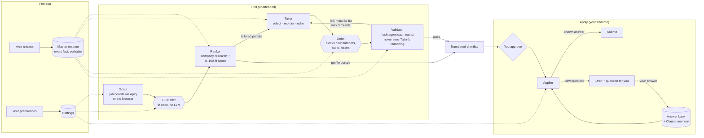

# Job Hunt Autopilot: a Claude skill

A Claude skill that runs your job search end to end:

1. **Finds** openings on job portals (Naukri, Instahyre, hirist.tech, foundit, LinkedIn, company careers sites).
2. **Ranks** each one honestly against your real resume, with company research.
3. **Tailors** a resume per job, with a linter that blocks any invented skill, number or claim, and an independent reviewer pass.
4. **Asks you to approve** the shortlist.
5. **Applies** in your own signed-in Chrome, through Claude in Chrome.
6. **Remembers your answers.** Any screening question it hasn't seen before is saved as a draft question for you. Your answer goes into an answer bank (and Claude's memory, if you allow it) and is reused on later forms.

On the first run it asks for your resume and preferences. Nothing about any other person is built in.

## How it works



### The roles

| Role | Job | Why it's separate |
|---|---|---|
| **Scout** | Pulls listings from each portal and pre-filters them in code (title, stack, location, experience, excluded employers, duplicates across portals). | Code handles the bulk filtering, so model calls are spent only on jobs that could fit. Full job descriptions are read only for the jobs that pass. |
| **Ranker** | Triages each job against the resume, researches the company (with a fixed budget, cached for 30 days), and scores fit on a weighted rubric. | It scores honestly: a weak match is skipped instead of costing an application slot. |
| **Tailor** | Builds a resume for one job by selecting, reordering and re-wording facts from the master resume. Every bullet carries the id of the fact it came from. | It can only rearrange the truth, never add to it. |
| **Validator** | Reviews the resume as the recruiter, the hiring manager and a skeptical interviewer, with a truthfulness check before any scoring. | A fresh agent each round, so it never grades its own work and is never swayed by the Tailor's reasoning. |
| **Applier** | Fills forms in your signed-in Chrome, answers from your profile and your past answers, and saves anything new as a draft question for you. | It never guesses. It saves your answer once and reuses it on later forms. |

### Design choices

- **The truth lives in one file.** The master resume is the single source. `resume_tool.py` lints every tailored resume against it and rejects any number, skill, employer gap or listed gap term that isn't there, before a reviewer ever sees it.
- **Generate and review are kept apart.** The Tailor and Validator loop for at most 3 rounds. The Validator gets only the files and the previous must-fix list, never the Tailor's change log.
- **A person stays in the loop where it counts.** Nothing is submitted without your approval. A new question, any "No", and any unfamiliar consent all wait for you.
- **The answer bank learns your voice.** Your answers are stored in your own words, along with notes on how you write. Later written answers reuse your substance and tone, and composed answers are logged for review, never saved as yours.
- **Cost stays low.** Filtering is rule-based, job descriptions are read in two passes, the Ranker triages before researching, company dossiers are cached, and subagents run on a smaller model.
- **Safe to run unattended.** A run lock prevents overlapping runs. There are caps per portal per day and human pacing. A run stops on any bot check, and it never enters passwords or OTPs.

## What you need

| | Needed? | Why |
|---|---|---|
| A Claude plan with Skills and code execution turned on | Yes | Runs the skill and renders resumes |
| Claude in Chrome extension, signed in to your job portals | To apply | Fills and submits forms in your browser |
| A claude.ai **Project** to run it in | Recommended | Keeps your files (resume, answers, job list) between chats; needed for scheduled runs |
| Apify connector and account | Recommended | Cheap job-board searching (a few cents to about $1 per portal per run, billed to your Apify account). Without it, the skill searches in the browser, which is slower. |
| Google Sheets connector | Optional | Application tracker |
| Claude desktop app with a folder added | For tailored resumes | Chrome can only upload a resume that is on your computer. Without it, use portals that keep your resume on your profile (Naukri, hirist.tech, foundit). |

## Install

### claude.ai (web, desktop app)

1. Download `job-hunt-autopilot.zip` from this repo's **Releases** page. To build it yourself, run `python tools/package.py`; the zip lands in `dist/`.
2. In Claude, go to **Customize → Skills → + → Create skill → Upload a skill**, and choose the zip.
3. Make sure the skill is toggled on.

### Claude Code

```
/plugin marketplace add JagadishGosala/job-hunt-autopilot
/plugin install job-hunt-autopilot@job-hunt-autopilot
```

## First run

Create a Project (for example "Job search"), open a chat in it, and say:

> Set up job hunt autopilot

Attach your resume when it asks. It then asks about:
- target roles and locations
- pay and notice period (both optional)
- portals to use and employers to skip
- daily caps
- whether to save your answers to memory

Then:

- **"Find jobs"** builds a shortlist and asks you to approve it.
- **"Apply to approved jobs"** applies. Keep Chrome open.
- **"Run my job search"** does both, asking you in between.
- **Reply with answers** to any open questions, and it finishes those drafts.
- **"Schedule my job search"** sets up daily scheduled tasks: find in the morning, apply in the evening.

## How your data is handled

- Everything about you lives in **your** Project (`job-hunt/` docs), and in Claude's memory if you allow it. This repo contains only instructions, scripts and a fictional example.
- **Your resume is never embellished.** A tailored resume can only reorder, trim and re-word facts from your own resume. A linter rejects any new number, skill or claim, and a separate reviewer checks every bullet against the source.
- **It never guesses a screening answer.** Anything it doesn't know is frozen as a draft question for you. It never answers "No" for you unless you've said it before.
- **It never** enters passwords or OTPs, creates accounts on external applicant systems, or solves CAPTCHAs. Those jobs are marked *blocked* for you to finish.
- **It only applies to jobs you approved,** at a human pace, within your daily cap per portal.

## Repo layout

```
skills/job-hunt-autopilot/
  SKILL.md                 orchestrator: modes, pipeline, rules
  references/setup.md      first-run onboarding
  references/storage-and-memory.md
  references/schemas.md
  references/scheduling.md
  references/agents/       scout, ranker, tailor, validator, applier
  scripts/resume_tool.py   render a resume PDF from the master resume, plus the anti-fabrication linter
  scripts/scout_filter.py  settings-driven pre-filter for job listings
  templates/               example settings and master resume (fictional), empty answer bank, scraper config
.claude-plugin/            Claude Code plugin + marketplace manifests
tools/package.py           builds dist/job-hunt-autopilot.zip
.github/workflows/release.yml  attaches the zip to each GitHub release
RELEASING.md               how to publish a new version
```

## Updating

New versions are published on the **Releases** page.
- **claude.ai:** download the new zip and upload it again. Your settings, resume and saved answers live in your Project, so nothing is lost.
- **Claude Code:** run `/plugin marketplace update job-hunt-autopilot`.

Maintainers: see [RELEASING.md](RELEASING.md).

## Notes

- Portals change their pages and scrapers break. When one does, the skill finds a replacement scraper and records it in your own store (`job-hunt/scout-actors.json`). PRs updating `templates/scout-actors.json` are welcome.
- Automated applying may be against some portals' terms. You are responsible for how you use it on each site.

## License

MIT
